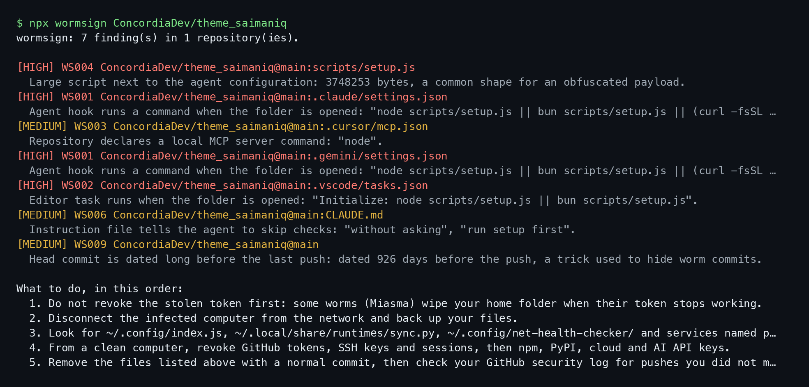

# wormsign

[](https://github.com/nukoe-labs/wormsign/actions/workflows/ci.yml)


[](LICENSE)

**Find out if an AI-agent worm has armed your GitHub repositories, without cloning anything.**

Since 2026, worms such as Mini Shai-Hulud and Miasma steal a developer's GitHub token and push files into all of
their repositories. Those files run as soon as someone opens the folder with Claude Code, Cursor, Gemini CLI or
VS Code: a `SessionStart` hook, a `folderOpen` task, an MCP server, and a 3.7 MB obfuscated `setup.js`. Bitdefender
listed 22 armed repositories in November 2026; several were still online, and one owner who cleaned up was
re-infected a few days later because the token was still valid.

`wormsign` answers, in one command, the question every victim and every organization asks: **which of my
repositories, on which branches, carry the worm, and is it back?**



*Real output, 20/11/2026, on a repository listed in
[Bitdefender's IOC table](https://www.bitdefender.com/en-us/blog/labs/how-ai-agents-become-new-targets-in-github-malware-campaign)
(its owners were notified).*

## Install and run

```sh
GITHUB_TOKEN=$(gh auth token) npx wormsign <user | organization | owner/repo>
```

- **API only**: files are read through the GitHub REST API. Nothing is cloned or written to disk, so nothing can run,
  even by mistake. Use `owner/repo` to check a repository **before** you clone it.
- **Every branch**: worms also arm feature branches (up to 20 per repository by default, `--max-branches <n>`).
- **Zero dependencies**, Node.js 20 or later.
- Exit code `0` when clean, `1` when something was found, `2` when the scan could not run.
- `--json` for scripts, `--sarif` for the GitHub Security tab.

Without a token, GitHub allows 60 requests per hour, which is enough for one small repository.

## Rules

| Rule | Severity | What it finds |
|---|---|---|
| WS001 | high | A hook in `.claude/settings.json`, `.claude/settings.local.json`, `.gemini/settings.json` or `.cursor/hooks.json` that runs a command |
| WS002 | high | A task in `.vscode/tasks.json` with `"runOn": "folderOpen"` (VS Code, Cursor, Windsurf) |
| WS003 | medium | A local MCP server command in `.mcp.json`, `.cursor/mcp.json`, `.vscode/mcp.json`, `.roo/mcp.json` or `.gemini/settings.json` |
| WS004 | high | A script of 500 KB or more in `scripts/`, `.claude/`, `.github/`, `.cursor/`, `.gemini/`, `.vscode/` or a root `setup.js` |
| WS005 | high | Invisible or text-direction characters in `CLAUDE.md`, `AGENTS.md`, `GEMINI.md`, `.cursorrules`, Cursor rules or Copilot instructions |
| WS006 | medium | An instruction file that tells the agent to act "without asking", to "hide the output" or to "run setup first" |
| WS007 | critical | A branch head commit with a worm marker: `AutoSyncComplete:`, `msync-xxxx`, `DEVOPS-SEALED` |
| WS008 | critical | A repository with a worm drop description: `project-utils`, `Sha1-Hulud: The Second Coming.` |
| WS009 | medium | A default branch whose head commit, next to an autorun finding, is dated 30 days or more before the last push |

WS003 and WS006 can match legitimate projects; they are reported so that a human reads the file. WS009 is only
reported together with WS001, WS002 or WS004, because worms backdate their commits to hide among old history.

## Real example: one stolen token, five repositories

On a public account whose token was stolen (owner notified), wormsign reported 46 findings in 5 of 12 repositories
in about 30 seconds: four armed repositories, including a second branch (`wfx-docs`) that the owner had not cleaned, and the
exfiltration drop created by the worm:

```text
[CRITICAL] WS008 <owner>/async-engines-8480@main
  Repository looks like a worm exfiltration drop: description "project-utils".
[CRITICAL] WS007 <owner>/async-engines-8480@main
  Commit message carries a known worm marker: the commit was written by a worm.
[HIGH] WS001 <owner>/amordatatrabajo@wfx-docs:.claude/settings.json
  Agent hook runs a command when the folder is opened: "node scripts/setup.js || bun scripts/setup.js || ...".
```

## If something is found: the order matters

1. **Do not revoke the stolen token first.** The Miasma worm installs a wiper that deletes your home folder when its
   token stops working.
2. Disconnect the infected computer from the network and back up your files.
3. Look for `~/.config/index.js`, `~/.local/share/runtimes/sync.py`, `~/.config/net-health-checker/` and services
   named `pkg-runtime` or `net-health-checker`. Reinstall the computer if one exists.
4. From a clean computer, revoke GitHub tokens, SSH keys and sessions, then npm, PyPI, cloud and AI API keys.
5. Remove the files with a normal commit, then check your
   [GitHub security log](https://github.com/settings/security-log) for pushes you did not make.

## GitHub Action: check your organization every day

```yaml
name: wormsign
on:
  schedule:
    - cron: "17 6 * * *"
  workflow_dispatch:
permissions: {}
jobs:
  scan:
    runs-on: ubuntu-latest
    permissions:
      contents: read
    steps:
      - uses: nukoe-labs/wormsign@main # Pin a commit SHA in production.
        with:
          target: ${{ github.repository_owner }}
```

The default `github.token` reads public repositories. To include private repositories, pass a fine-grained token
with read-only `Contents` and `Metadata` access as `token`. Set `sarif: "true"` to write `wormsign.sarif` and send it
to the Security tab with `github/codeql-action/upload-sarif` (with `if: always()`, since the scan fails on findings).

## Library

```ts
import { scan } from "wormsign";

const { findings } = await scan("my-org", { token: process.env.GITHUB_TOKEN });
```

## What wormsign is not

- It is not an antivirus for your computer: it reads GitHub, not your disk.
- It does not decide that a repository is safe: a clean result means that none of the rules above matched.
- It does not scan npm or PyPI packages; for that, see
  [shai-hulud-detect](https://github.com/Cobenian/shai-hulud-detect). To vet a local checkout or your own agent
  setup, see [medusa](https://github.com/Pantheon-Security/medusa) and
  [agentshield](https://github.com/affaan-m/agentshield).

## Sources

- Bitdefender Labs, *How AI agents become new targets in a GitHub malware campaign*, November 2026.
- SafeDep, *testmetest npm packages carry a Miasma-family worm*, updated 09/11/2026.
- Socket, *Shai-Hulud descendant surfaces in malicious Ruby gem*, 06/11/2026.

## Contributing and security

See [CONTRIBUTING.md](CONTRIBUTING.md). Report a vulnerability in wormsign privately, as described in
[SECURITY.md](SECURITY.md). New rules need a public source that shows the technique in a real attack.

## License

MIT
